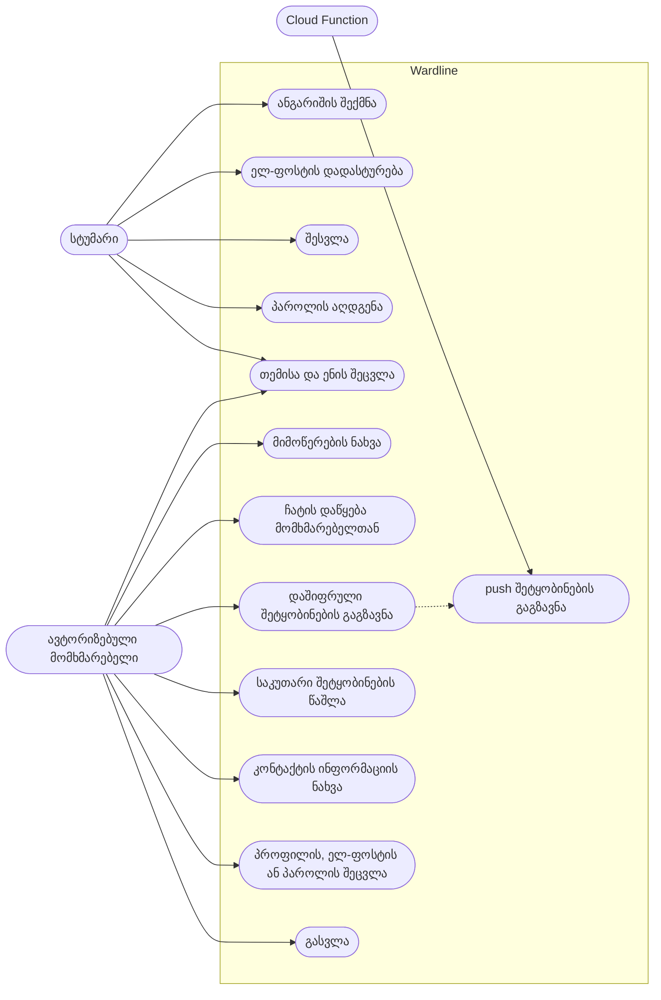
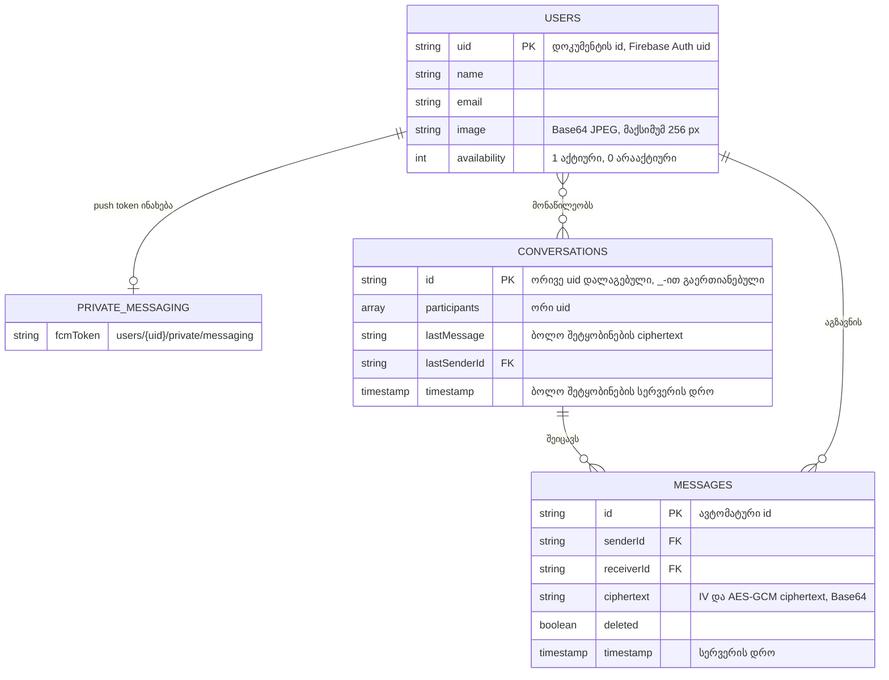

<div align="center">

# Wardline

Android-ის მესენჯერი პირადი მიმოწერისთვის, სადაც შეტყობინებები ტელეფონზევე იშიფრება AES-GCM-ით, სანამ Firebase-ში შეინახება.


[English](README.md) | **ქართული**


</div>

## შესახებ

Wardline-ში შეგიძლიათ ელ-ფოსტით დარეგისტრირდეთ, იპოვოთ სხვა მომხმარებლები და მათ პირადად მიწეროთ. შეტყობინებები Firestore-ში ჩაწერამდე ტელეფონზევე იშიფრება AES-256-GCM-ით, ამიტომ ბაზაში მხოლოდ ciphertext ინახება. აპლიკაციას აქვს ღია და მუქი თემა და ხელმისაწვდომია ინგლისურ, ქართულ და რუსულ ენებზე.

პირველი ვერსია 2024 წელს საბაკალავრო პროექტად შევქმენი: მინდოდა Java-ზე Android-ის დეველოპმენტი და real-time backend-თან მუშაობა მესწავლა. 2026 წელს პროექტს დავუბრუნდი და თავიდან გადავაკეთე: კოდიდან ამოვიღე იქ შენახული პაროლები და გასაღებები, ჩემი ძველი AES/ECB დაშიფვრა AES-GCM-ით ჩავანაცვლე და მისი გასაღები კოდიდან გავიტანე, დავწერე Firestore-ის security rules და მათი ტესტები, ინტერფეისი კი Material 3-ზე გადავიყვანე. ამ პროექტმა იმდენივე მასწავლა საიდუმლო მონაცემებთან სწორად მოპყრობაზე, რამდენიც თავად Android-ზე.

> **შენიშვნა:** ეს სასწავლო პროექტია და არა რეალური მომხმარებლებისთვის მზა მესენჯერი. ეკრანის სურათებზე ნაჩვენები მომხმარებლები და შეტყობინებები გამოგონილი სატესტო მონაცემებია, რომლებიც ლოკალურ Firebase emulator-ებში შევქმენი.

## სარჩევი

- [ფუნქციები](#ფუნქციები)
- [ეკრანის სურათები](#ეკრანის-სურათები)
- [გამოყენების შემთხვევების დიაგრამა](#გამოყენების-შემთხვევების-დიაგრამა)
- [მონაცემთა ბაზა](#მონაცემთა-ბაზა)
- [ტექნოლოგიები](#ტექნოლოგიები)
- [პროექტის სტრუქტურა](#პროექტის-სტრუქტურა)
- [გაშვება](#გაშვება)
- [მონაცემებზე წვდომა](#მონაცემებზე-წვდომა)
- [უსაფრთხოება](#უსაფრთხოება)
- [გამოყენებული რესურსები](#გამოყენებული-რესურსები)
- [ლიცენზია](#ლიცენზია)

## ფუნქციები

**ანგარიში**
- შექმენით ანგარიში სახელით, ელ-ფოსტით, პაროლით (მინიმუმ 8 სიმბოლო) და პროფილის ფოტოთი, რომელსაც სისტემის photo picker-ით აირჩევთ.
- პირველ შესვლამდე დაადასტურეთ ელ-ფოსტა; საჭიროების შემთხვევაში აპლიკაცია ბმულს ხელახლა გამოგიგზავნით.
- მოითხოვეთ პაროლის აღდგენის წერილი.
- შეცვალეთ პაროლი, ელ-ფოსტა (ახალ მისამართზე გამოგზავნილი ბმულით დადასტურების შემდეგ) ან პროფილის ფოტო.
- გამოდით ანგარიშიდან; ამ დროს მოწყობილობის push token-იც იშლება.

**ჩატები**
- ნახეთ ყველა მიმოწერა, უახლესი ზემოთ, ბოლო შეტყობინების ტექსტთან ერთად.
- დაიწყეთ ახალი ჩატი ნებისმიერ დარეგისტრირებულ მომხმარებელთან.
- გააგზავნეთ ტექსტური შეტყობინება 2000 სიმბოლომდე.
- ნახეთ, აქვს თუ არა თანამოსაუბრეს ამ წუთას აპლიკაცია გახსნილი („აქტიურია“).
- წაშალეთ საკუთარი შეტყობინება ხანგრძლივი შეხებით; ის ორივე მხარეს ქრება.
- გახსენით თანამოსაუბრის კონტაქტის ინფორმაცია.

**Push შეტყობინებები**
- მიიღეთ push შეტყობინება ახალ წერილზე, როცა აპლიკაცია დახურულია; ტექსტი ტელეფონზევე გაიშიფრება.

**პერსონალიზაცია**
- გადართეთ ღია და მუქ თემას შორის.
- შეცვალეთ ენა (ინგლისური, ქართული, რუსული) აპლიკაციაში ან Android-ის per-app language პარამეტრებში.

## ეკრანის სურათები

| შესვლა | ანგარიშის შექმნა |
| :---: | :---: |
|  |  |
| **მიმოწერები** | **ჩატი** |
|  |  |
| **ახალი ჩატი** | **კონტაქტის ინფორმაცია** |
|  |  |
| **პროფილი** | **პარამეტრები** |
|  |  |
| **მუქი თემა** | **ჩატი მუქ თემაში** |
|  |  |
| **ქართული ინტერფეისი** | **შესვლა ქართულად** |
|  |  |

## გამოყენების შემთხვევების დიაგრამა



## მონაცემთა ბაზა



მონაცემები Cloud Firestore-შია, ამიტომ ეს SQL ცხრილები კი არა, დოკუმენტების კოლექციებია: ყველა მომხმარებელს აქვს პროფილის დოკუმენტი და push token-ისთვის დახურული ქვედოკუმენტი, ყოველ ორ მომხმარებელს კი ერთი საერთო conversation დოკუმენტი, რომლის `messages` ქვეკოლექციაში დაშიფრული შეტყობინებები ინახება.

## ტექნოლოგიები

| ფენა | ტექნოლოგია |
| --- | --- |
| ენა | Java 17 |
| Android | minSdk 29, targetSdk 36, compileSdk 37, view binding |
| ინტერფეისი | Material Components 1.14.0 (Material 3), AndroidX AppCompat, RecyclerView, ConstraintLayout |
| ავტორიზაცია | Firebase Authentication (ელ-ფოსტა და პაროლი) |
| მონაცემთა ბაზა | Cloud Firestore |
| Push შეტყობინებები | Firebase Cloud Messaging, რომელსაც Cloud Function აგზავნის (Node.js 22, firebase-functions 7) |
| დაშიფვრა | AES-256-GCM (`javax.crypto`), გასაღები `local.properties`-იდან |
| Build | Gradle 9.8.1, Kotlin DSL და version catalog, Android Gradle Plugin 9.3.0, R8 |
| ტესტები | JUnit 4, AndroidX Test, Firestore rules-ის ტესტები `@firebase/rules-unit-testing`-ით |
| CI | GitHub Actions, Dependabot |

## პროექტის სტრუქტურა

```
.
├── app/
│   ├── build.gradle.kts                  # app მოდული: SDK ვერსიები, dependencies, ჩატის გასაღები, emulator-ის გადამრთველი
│   ├── google-services.json.example      # Firebase-ის კონფიგურაციის შაბლონი სადემონსტრაციო პროექტისთვის
│   └── src/
│       ├── main/
│       │   ├── AndroidManifest.xml       # Activity-ები, messaging service, backup-ისა და ქსელის წესები
│       │   ├── java/io/github/mrtabaofficial/wardline/
│       │   │   ├── MyApplication.java    # მუქი თემა; debug-ში ლოკალურ emulator-ებთან დაკავშირება
│       │   │   ├── activities/           # შესვლა, რეგისტრაცია, მიმოწერები, ჩატი, მომხმარებლები, პროფილები, პარამეტრები
│       │   │   ├── adapters/             # RecyclerView adapter-ები ჩატის, მიმოწერებისა და მომხმარებლებისთვის
│       │   │   ├── crypto/               # MessageCipher (AES-256-GCM)
│       │   │   ├── firebase/             # MessagingService (FCM) და PushTokens
│       │   │   ├── listeners/            # სიებზე დაჭერის callback-ები
│       │   │   ├── models/               # User და ChatMessage
│       │   │   └── utilities/            # Constants, conversation id-ები, სურათები, insets, preferences
│       │   └── res/                      # Layout-ები, Material 3 თემა, აიკონები, en/ka/ru ტექსტები
│       ├── debug/res/xml/                # მხოლოდ debug-ის ქსელის კონფიგურაცია ლოკალური emulator-ებისთვის
│       ├── test/                         # JVM unit ტესტები დაშიფვრისა და conversation id-ებისთვის
│       └── androidTest/                  # instrumented ტესტი, რომ მითითებული გასაღები მოწყობილობაზე მუშაობს
├── functions/
│   └── index.js                          # Cloud Function, რომელიც push შეტყობინებებს აგზავნის
├── firestore-tests/
│   └── firestore.rules.test.js           # security rules-ის ტესტები Firestore emulator-ისთვის
├── firestore.rules                       # Firestore-ის security rules
├── firebase.json                         # Firebase CLI-ის კონფიგურაცია: rules, functions, emulator-ების პორტები
├── gradle/libs.versions.toml             # version catalog ყველა dependency-ის ვერსიით
├── docs/screenshots/                     # ამ README-ში გამოყენებული ეკრანის სურათები
└── .github/                              # CI workflow და Dependabot-ის კონფიგურაცია
```

## გაშვება

ეს ნაბიჯები აპლიკაციას Firebase Local Emulator Suite-თან უშვებს, ამიტომ Firebase-ის პროექტი და გასაღებები არ დაგჭირდებათ.

### მოთხოვნები

- Android Studio, რომელიც Android Gradle Plugin 9.3-ს უჭერს მხარს, ან Android SDK დაინსტალირებული platform 37-ით
- JDK 21 (Gradle-ს სჭირდება JDK 17 ან უფრო ახალი, Firestore emulator-ს კი JDK 21)
- Node.js 22 ან უფრო ახალი
- Android emulator ან მოწყობილობა Android 10-ით (API 29) ან უფრო ახლით

### ლოკალურად გაშვება

1. დააკლონეთ რეპოზიტორია:

   ```bash
   git clone https://github.com/MrTabaOfficial/wardline.git
   cd wardline
   ```

2. გამოიყენეთ სადემონსტრაციო Firebase-ის კონფიგურაცია. ის მიუთითებს project id-ზე `demo-wardline`, რომელსაც emulator-ები რეალური პროექტის გარეშე იღებენ:

   ```bash
   cp app/google-services.json.example app/google-services.json
   ```

3. შექმენით დაშიფვრის გასაღები. ის ინახება `local.properties`-ში, რომელიც Git-ში არ იტვირთება, და build-ის დროს აპლიკაციაში `BuildConfig.CHAT_AES_KEY`-ად ჩაიწერება. თუ გასაღები არ არის, build შეჩერდება და შეტყობინებას გაჩვენებთ:

   ```bash
   echo "chat.aesKey=$(openssl rand -base64 32)" >> local.properties
   ```

4. გაუშვით Authentication-ისა და Firestore-ის emulator-ები. ეს ქმნის ცარიელ ბაზას და ტვირთავს `firestore.rules`-ს; ტერმინალი ღია დატოვეთ:

   ```bash
   npx firebase-tools@15 emulators:start --only auth,firestore --project demo-wardline
   ```

5. მეორე ტერმინალში ჩართეთ Android emulator, შემდეგ ააწყვეთ აპლიკაცია ისე, რომ თქვენს კომპიუტერზე გაშვებულ emulator-ებს დაუკავშირდეს (`10.0.2.2` არის კომპიუტერის მისამართი Android emulator-იდან), და დააინსტალირეთ:

   ```bash
   ./gradlew assembleDebug -PfirebaseEmulatorHost=10.0.2.2
   adb install -r app/build/outputs/apk/debug/app-debug.apk
   ```

   Windows-ზე `./gradlew`-ის ნაცვლად გამოიყენეთ `gradlew.bat`.

6. შექმენით პირველი ანგარიში. გახსენით აპლიკაცია, დააჭირეთ **ანგარიშის შექმნა**-ს, აირჩიეთ პროფილის ფოტო და შეავსეთ ფორმა. emulator-ის ტერმინალში დაიბეჭდება მსგავსი ხაზი:

   ```text
   To verify the email address you@example.com, follow this link: http://127.0.0.1:9099/emulator/action?mode=verifyEmail&...
   ```

   გახსენით ეს ბმული ბრაუზერში და შემდეგ შედით იგივე ელ-ფოსტითა და პაროლით.

7. სამიმოწეროდ მეორე ანგარიშიც დაგჭირდებათ. გამოდით პროფილის ეკრანიდან, შექმენით ახალი ანგარიში იგივე გზით და შემდეგ ისევ პირველი მომხმარებლით შედით.

### ტესტების გაშვება

```bash
# JVM unit ტესტები: დაშიფვრა და conversation id-ები
./gradlew testDebugUnitTest

# instrumented ტესტი გასაღებისთვის (სჭირდება ჩართული emulator; ბოლოს აპლიკაციას შლის)
./gradlew connectedDebugAndroidTest

# Firestore security rules-ის ტესტები
cd firestore-tests
npm install
npx firebase-tools@15 emulators:exec --only firestore --project demo-wardline --config ../firebase.json "npm test"
```

### რეალურ Firebase პროექტთან დაკავშირება

1. Firebase console-ში დაამატეთ Android აპლიკაცია package name-ით `io.github.mrtabaofficial.wardline`, ჩამოტვირთეთ მისი `google-services.json` `app/` საქაღალდეში და ჩართეთ Email/Password ავტორიზაცია, Cloud Firestore და Cloud Messaging.
2. გაუშვით rules-ისა და function-ის deploy (Cloud Functions-ს Blaze გეგმა სჭირდება):

   ```bash
   npx firebase-tools@15 login
   npx firebase-tools@15 use --add
   npx firebase-tools@15 deploy --only firestore:rules
   cd functions && npm install && cd ..
   npx firebase-tools@15 deploy --only functions
   ```

3. ააწყვეთ აპლიკაცია emulator-ის გადამრთველის გარეშე: `./gradlew assembleDebug`. ყველა build-მა, რომლის მომხმარებლებიც ერთმანეთის შეტყობინებებს კითხულობენ, ერთი და იგივე `chat.aesKey` უნდა გამოიყენოს.

## მონაცემებზე წვდომა

აპლიკაციას საკუთარი HTTP API არ აქვს. ის პირდაპირ Firestore-ს კითხულობს და მასში წერს, ხოლო `firestore.rules` წყვეტს, ვის რისი უფლება აქვს. „დადასტურებული მომხმარებელი“ ნიშნავს ავტორიზებულს დადასტურებული ელ-ფოსტით.

| ოპერაცია | Path | ვის შეუძლია | დანიშნულება |
| --- | --- | --- | --- |
| read | `users/{uid}` | ნებისმიერ დადასტურებულ მომხმარებელს | მომხმარებლების სია, სახელები, ფოტოები და სტატუსი |
| create | `users/{uid}` | ახალ ანგარიშს, დადასტურებამდე | პროფილის შენახვა რეგისტრაციისას |
| update | `users/{uid}` | მფლობელს, დადასტურების შემდეგ | სახელის, ელ-ფოსტის, ფოტოს ან სტატუსის შეცვლა |
| read, write | `users/{uid}/private/messaging` | მფლობელს | მოწყობილობის FCM token-ის შენახვა |
| read (query) | `conversations`, სადაც `participants` ჩემს uid-ს შეიცავს | დადასტურებულ მონაწილეებს | მიმოწერების სიის ჩვენება |
| create, update | `conversations/{uidA_uidB}` | დადასტურებულ მონაწილეებს | ბოლო შეტყობინების დაშიფრული ტექსტის განახლება |
| read | `conversations/{uidA_uidB}/messages` | დადასტურებულ მონაწილეებს | შეტყობინებების ჩატვირთვა და მოსმენა |
| create | `conversations/{uidA_uidB}/messages/{id}` | გამგზავნს, დადასტურების შემდეგ | ორივე მონაწილისთვის დაშიფრული შეტყობინების გაგზავნა |
| update | `conversations/{uidA_uidB}/messages/{id}` | თავდაპირველ გამგზავნს | შეტყობინების წაშლა მისი ciphertext-ის გასუფთავებით |
| trigger | ახალი `conversations/{id}/messages/{id}` | Cloud Function `notifyOnNewMessage` | მიმღებისთვის push შეტყობინების გაგზავნა |

push token-ის დოკუმენტის გარდა, რომელსაც მფლობელი გასვლისას შლის, აპლიკაციიდან დოკუმენტის წაშლა შეუძლებელია, ხოლო ყველა სხვა path დახურულია.

## უსაფრთხოება

რას აკეთებს კოდი:

- შეტყობინებები მოწყობილობაზე იშიფრება AES-256-GCM-ით, ყოველ შეტყობინებაზე ახალი შემთხვევითი IV-ით. გამგზავნისა და მიმღების id-ები associated data-დ არის მიბმული, ამიტომ ciphertext-ის სხვა მიმოწერაში გადატანა შეუძლებელია, ხოლო მისი ნებისმიერი ცვლილება შეინიშნება.
- გასაღები build-ის დროს იკითხება `local.properties`-იდან და რეპოზიტორიაში არასდროს ხვდება; თუ ის არ არის ან 32 ბაიტი არ არის, build ჩერდება.
- Firestore-ში მხოლოდ ciphertext ინახება, მიმოწერის ბოლო შეტყობინების ჩათვლით. შეტყობინების წაშლისას მისი ciphertext ორივე მხარისთვის ქრება.
- security rules ამოწმებს ავტორიზაციას, ელ-ფოსტის დადასტურებას, მონაწილეებს, გამგზავნის ვინაობას, დაშვებულ ველებსა და ველების ზომას. მათ ფარავს emulator-ზე გაშვებული 23 ტესტი.
- შესვლისთვის საჭიროა დადასტურებული ელ-ფოსტა, ხოლო პაროლის აღდგენის შეტყობინება არ ამხელს, არსებობს თუ არა ასეთი ანგარიში.
- push token-ები ინახება დოკუმენტში, რომლის წაკითხვაც მხოლოდ მფლობელს შეუძლია. Push შეტყობინებებს სერვერი აგზავნის Admin SDK-ით, ამიტომ აპლიკაციაში messaging-ის გასაღები არ არის.
- დაუშიფრავი ქსელური ტრაფიკი დაბლოკილია; HTTP-ით ლოკალურ emulator-ებთან კავშირი მხოლოდ debug build-ს შეუძლია.
- აპლიკაციის მონაცემები გამორიცხულია cloud backup-იდან და მოწყობილობებს შორის გადატანიდან, ამიტომ სესია მოწყობილობაზე რჩება.
- release build-ები R8-ით მცირდება. რეპოზიტორიაში API key-ები და პაროლები არ არის; `google-services.json` Git-ში არ იტვირთება.

რა უნდა შეიცვალოს რეალურ მომხმარებლებზე გაშვებამდე:

- გაუშვით `firestore.rules`-ის deploy და Google Cloud console-ში შეზღუდეთ Firebase-ის API key აპლიკაციის package name-ითა და ხელმოწერის სერტიფიკატით.
- არასდროს გაავრცელოთ `-PfirebaseEmulatorHost`-ით აწყობილი build.
- განიხილეთ Firebase App Check, რომელსაც ეს პროექტი არ იყენებს.
- გაითვალისწინეთ შეზღუდვები: აპლიკაციის ყველა ასლში ერთი და იგივე გასაღებია, ამიტომ ვინც APK-ს გახსნის, შეუძლია გაშიფროს ის შეტყობინებები, რომელთა წაკითხვაც Firestore-იდან შეუძლია. დაშიფვრა უზრუნველყოფს, რომ ბაზაში ტექსტი წაკითხვადი სახით არ ინახებოდეს, ხოლო სხვა მომხმარებლებს მიმოწერის წაკითხვაში security rules უშლის ხელს. ეს end-to-end დაშიფვრა არ არის, გასაღების შეცვლის შემდეგ ძველი შეტყობინებები აღარ იკითხება და ყველა დადასტურებული მომხმარებელი ხედავს სხვების სახელსა და ელ-ფოსტას.

## გამოყენებული რესურსები

| კომპონენტი | ლიცენზია |
| --- | --- |
| [AndroidX](https://developer.android.com/jetpack/androidx) (AppCompat, Activity, Core, RecyclerView, ConstraintLayout) | Apache 2.0 |
| [Material Components for Android](https://github.com/material-components/material-components-android) | Apache 2.0 |
| [Firebase Android SDK](https://github.com/firebase/firebase-android-sdk) (Auth, Firestore, Messaging) | Apache 2.0 |
| [firebase-admin](https://github.com/firebase/firebase-admin-node) | Apache 2.0 |
| [firebase-functions](https://github.com/firebase/firebase-functions) | MIT |
| [Firebase JS SDK](https://github.com/firebase/firebase-js-sdk) და `@firebase/rules-unit-testing` (მხოლოდ ტესტებში) | Apache 2.0 |
| [JUnit 4](https://junit.org/junit4/) (მხოლოდ ტესტებში) | EPL 1.0 |
| [Material Icons](https://github.com/google/material-design-icons) (აპლიკაციის აიკონები) | Apache 2.0 |

ეკრანის სურათებზე ნაჩვენები ავატარები გენერირებული ინიციალებია და არა რეალური ადამიანების ფოტოები.

## ლიცენზია

ვრცელდება [MIT ლიცენზიით](LICENSE). Copyright (c) 2024 MrTabaOfficial.
