<div align="center">

# Wardline

An Android messenger for one-to-one chats, where messages are encrypted with AES-GCM on the phone before they are stored in Firebase.


**English** | [ქართული](README.ka.md)

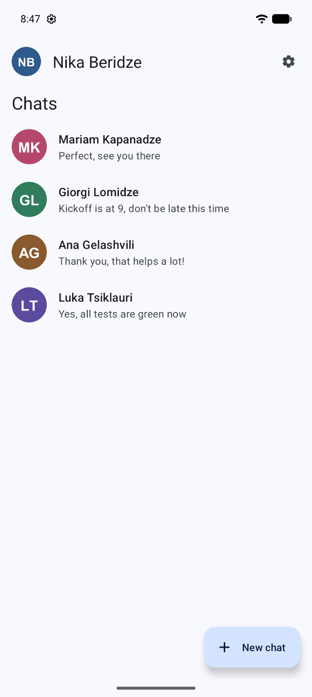

</div>

## About

Wardline lets people create an account with their email address, find other registered users and chat with them one to one. Messages are encrypted on the phone with AES-256-GCM before they are written to Firestore, so the database holds only ciphertext. The app has a light and a dark theme and is available in English, Georgian and Russian.

I built the first version in 2024 as my bachelor's project to learn Android development in Java with a real-time backend. In 2026 I went back to it and reworked it: I removed credentials that had been committed to the code, replaced my home-made AES/ECB encryption with AES-GCM and moved its key out of the code, wrote Firestore security rules and tests for them, and moved the interface to Material 3. The project taught me as much about what not to do with secrets as about Android itself.

> **Note:** This is a learning project, not a production messenger. The users and messages in the screenshots are made-up sample data that I created in the local Firebase emulators.

## Contents

- [Features](#features)
- [Screenshots](#screenshots)
- [Use case diagram](#use-case-diagram)
- [Database](#database)
- [Tech stack](#tech-stack)
- [Project structure](#project-structure)
- [Setup](#setup)
- [Data access](#data-access)
- [Security](#security)
- [Credits](#credits)
- [License](#license)

## Features

**Account**
- Create an account with a name, email, password (at least 8 characters) and a profile photo chosen with the system photo picker.
- Verify the email address before the first sign-in; the app offers to resend the link.
- Request a password reset email.
- Change the password, the email address (confirmed through a link sent to the new address) or the profile photo.
- Sign out, which also removes the device's push token.

**Chats**
- See all conversations, newest first, with a preview of the last message.
- Start a new chat with any registered user.
- Send text messages of up to 2,000 characters.
- See whether the other person currently has the app open ("Online").
- Delete your own message with a long press; it disappears for both people.
- Open the other person's contact info.

**Notifications**
- Get a push notification for a new message while the app is closed; the preview is decrypted on the phone.

**Personalisation**
- Switch between light and dark mode.
- Switch the language between English, Georgian and Russian in the app or in Android's per-app language settings.

## Screenshots

| Sign in | Create account |
| :---: | :---: |
| 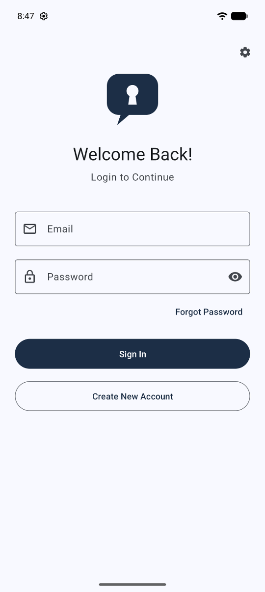 | 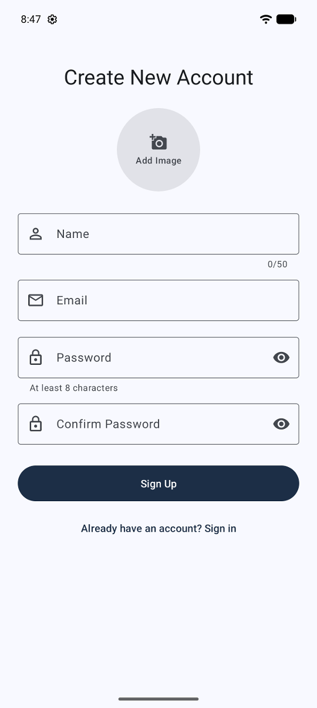 |
| **Conversations** | **Chat** |
|  | 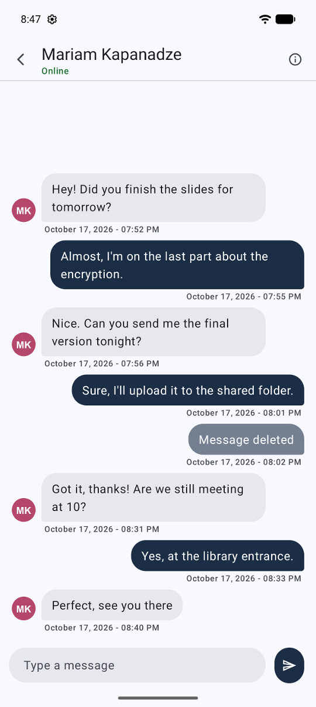 |
| **New chat** | **Contact info** |
| 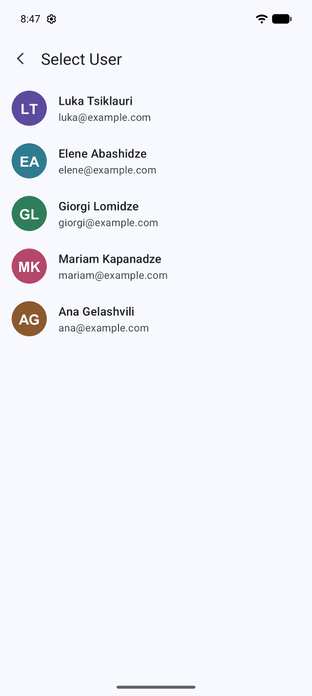 | 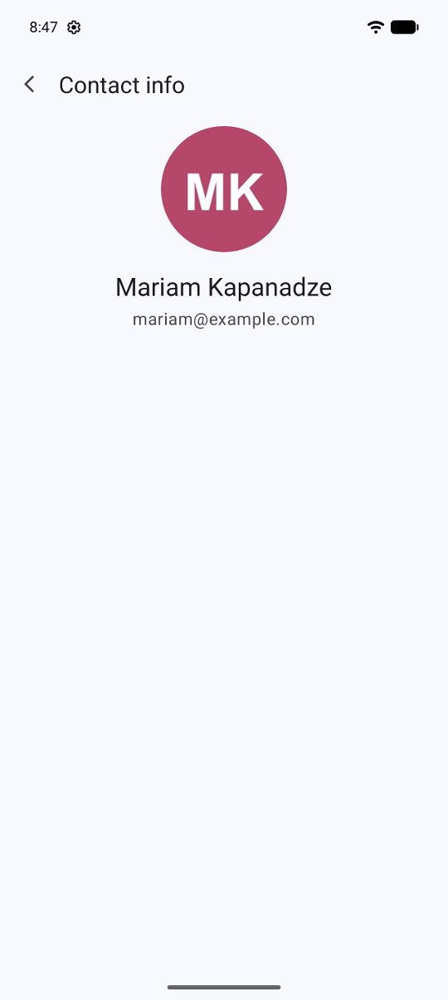 |
| **Profile** | **Settings** |
| 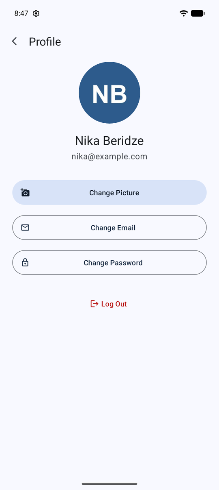 | 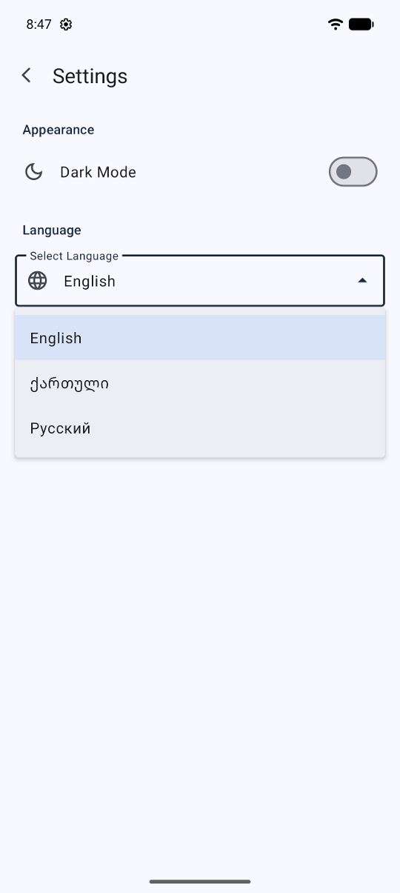 |
| **Dark mode** | **Dark mode chat** |
| 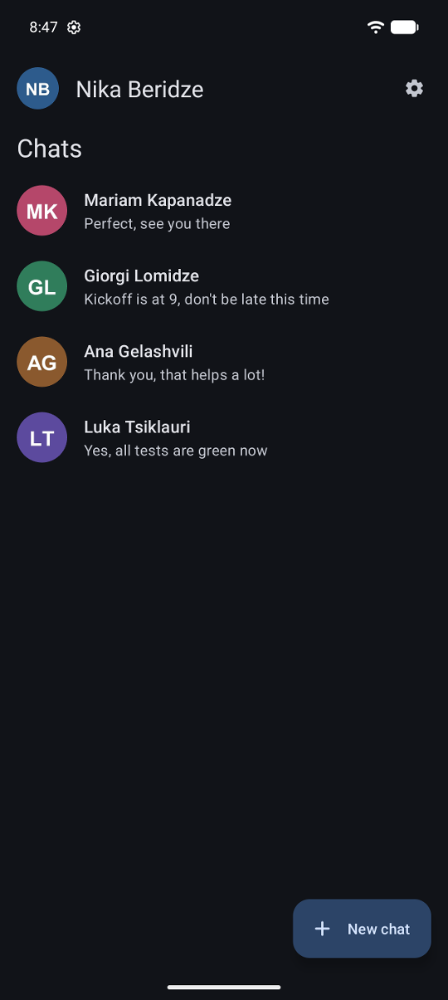 | 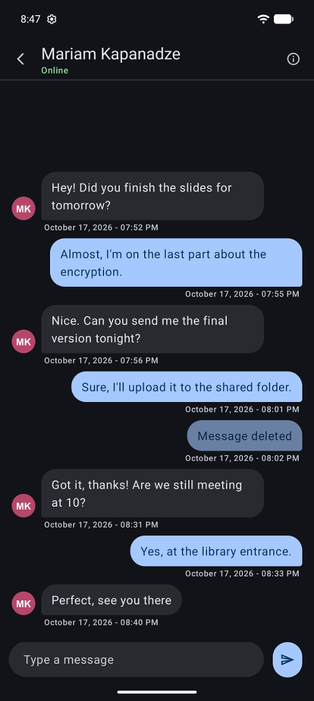 |
| **Georgian interface** | **Georgian sign in** |
| 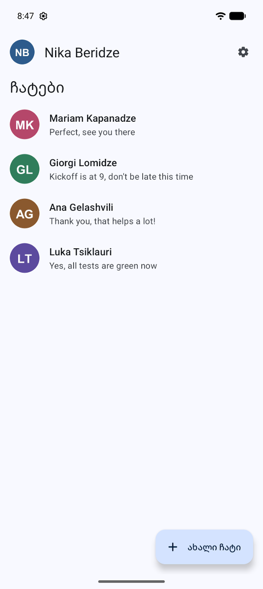 | 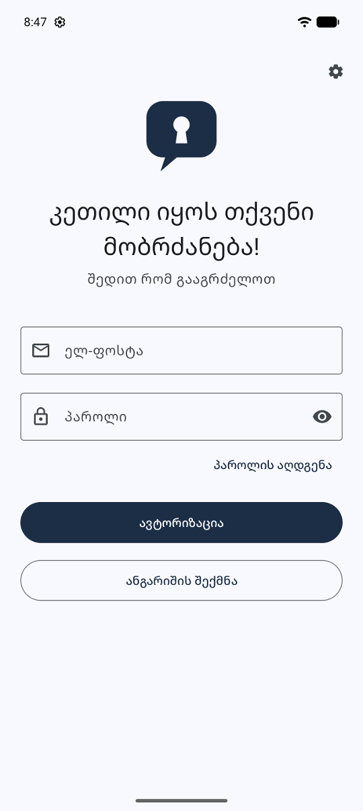 |

## Use case diagram

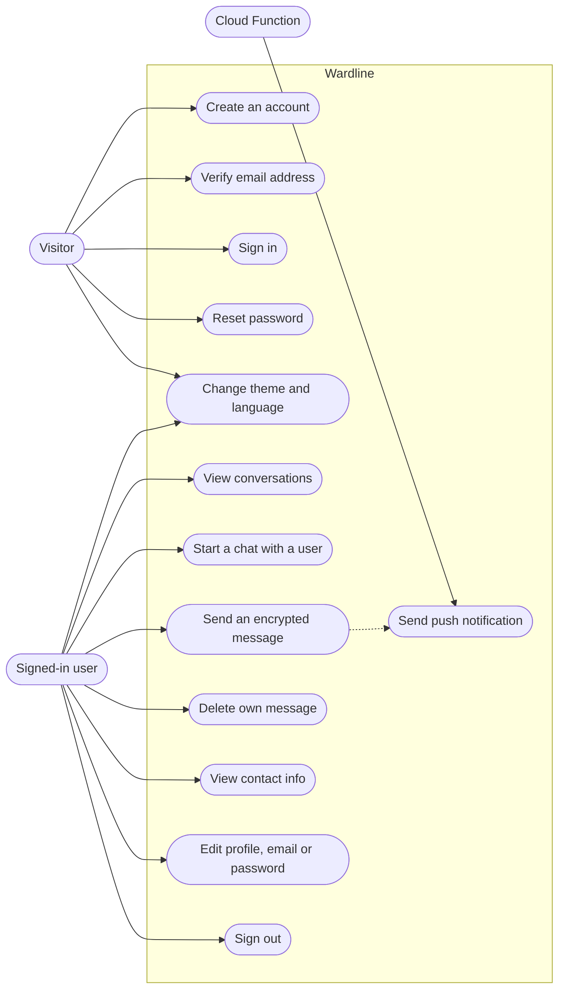

## Database

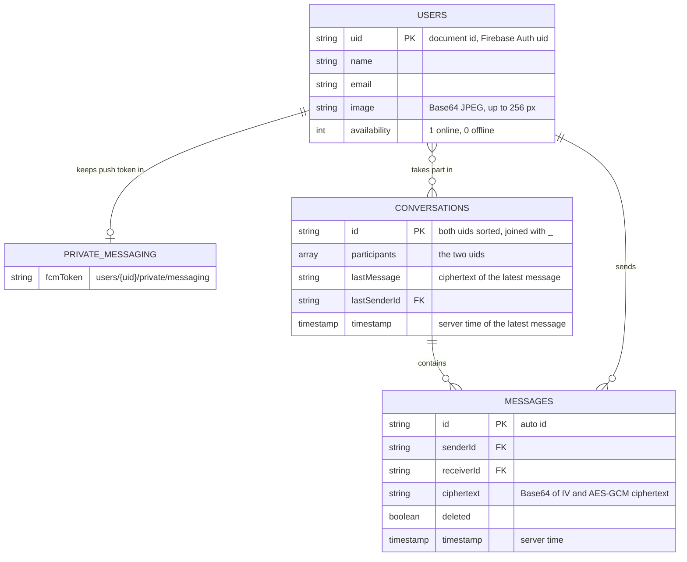

The data lives in Cloud Firestore, so these are collections of documents rather than SQL tables: every user has a profile document with a private sub-document for the push token, and each pair of users shares one conversation document whose `messages` sub-collection holds the encrypted messages.

## Tech stack

| Layer | Technology |
| --- | --- |
| Language | Java 17 |
| Android | minSdk 29, targetSdk 36, compileSdk 37, view binding |
| UI | Material Components 1.14.0 (Material 3), AndroidX AppCompat, RecyclerView, ConstraintLayout |
| Authentication | Firebase Authentication (email and password) |
| Database | Cloud Firestore |
| Push notifications | Firebase Cloud Messaging, sent by a Cloud Function (Node.js 22, firebase-functions 7) |
| Encryption | AES-256-GCM (`javax.crypto`), key from `local.properties` |
| Build | Gradle 9.8.1 with Kotlin DSL and a version catalog, Android Gradle Plugin 9.3.0, R8 |
| Tests | JUnit 4, AndroidX Test, Firestore rules tests with `@firebase/rules-unit-testing` |
| CI | GitHub Actions, Dependabot |

## Project structure

```
.
├── app/
│   ├── build.gradle.kts                  # App module: SDK levels, dependencies, chat key, emulator switch
│   ├── google-services.json.example      # Firebase config template for the demo project
│   └── src/
│       ├── main/
│       │   ├── AndroidManifest.xml       # Activities, messaging service, backup and network rules
│       │   ├── java/io/github/mrtabaofficial/wardline/
│       │   │   ├── MyApplication.java    # Applies dark mode, connects to the local emulators in debug
│       │   │   ├── activities/           # Sign in, sign up, conversations, chat, users, profiles, settings
│       │   │   ├── adapters/             # RecyclerView adapters for chats, conversations and users
│       │   │   ├── crypto/               # MessageCipher (AES-256-GCM)
│       │   │   ├── firebase/             # MessagingService (FCM) and PushTokens
│       │   │   ├── listeners/            # Click callbacks for the lists
│       │   │   ├── models/               # User and ChatMessage
│       │   │   └── utilities/            # Constants, conversation ids, images, insets, preferences
│       │   └── res/                      # Layouts, Material 3 theme, icons, en/ka/ru strings
│       ├── debug/res/xml/                # Debug-only network config that allows the local emulators
│       ├── test/                         # JVM unit tests for the cipher and conversation ids
│       └── androidTest/                  # Instrumented test that the configured key works on a device
├── functions/
│   └── index.js                          # Cloud Function that sends push notifications
├── firestore-tests/
│   └── firestore.rules.test.js           # Security rules tests for the Firestore emulator
├── firestore.rules                       # Firestore security rules
├── firebase.json                         # Firebase CLI config: rules, functions, emulator ports
├── gradle/libs.versions.toml             # Version catalog with every dependency version
├── docs/screenshots/                     # Screenshots used in this README
└── .github/                              # CI workflow and Dependabot config
```

## Setup

These steps run the app against the Firebase Local Emulator Suite, so you do not need a Firebase project or any keys.

### Requirements

- Android Studio with support for Android Gradle Plugin 9.3, or the Android SDK with platform 37 installed
- JDK 21 (Gradle needs JDK 17 or newer; the Firestore emulator needs JDK 21)
- Node.js 22 or newer
- An Android emulator or device running Android 10 (API 29) or newer

### Run the app locally

1. Clone the repository:

   ```bash
   git clone https://github.com/MrTabaOfficial/wardline.git
   cd wardline
   ```

2. Use the demo Firebase config. It points at the project id `demo-wardline`, which the emulators accept without a real project:

   ```bash
   cp app/google-services.json.example app/google-services.json
   ```

3. Create the encryption key. It goes into `local.properties`, which Git ignores, and is built into the app as `BuildConfig.CHAT_AES_KEY`. The build stops with a message if it is missing:

   ```bash
   echo "chat.aesKey=$(openssl rand -base64 32)" >> local.properties
   ```

4. Start the Authentication and Firestore emulators. This creates an empty database and loads `firestore.rules`; keep the terminal open:

   ```bash
   npx firebase-tools@15 emulators:start --only auth,firestore --project demo-wardline
   ```

5. In a second terminal, start an Android emulator, then build the app so it connects to the emulators on your computer (`10.0.2.2` is the host address seen from the Android emulator) and install it:

   ```bash
   ./gradlew assembleDebug -PfirebaseEmulatorHost=10.0.2.2
   adb install -r app/build/outputs/apk/debug/app-debug.apk
   ```

   On Windows, use `gradlew.bat` instead of `./gradlew`.

6. Create the first account. Open the app, tap **Create New Account**, pick a profile photo and fill in the form. The emulator terminal then prints a line like this:

   ```text
   To verify the email address you@example.com, follow this link: http://127.0.0.1:9099/emulator/action?mode=verifyEmail&...
   ```

   Open that link in a browser, then sign in with the same email and password.

7. To chat, you need a second account. Sign out from the profile screen and create one the same way, then sign back in as the first user.

### Run the tests

```bash
# JVM unit tests: encryption and conversation ids
./gradlew testDebugUnitTest

# Instrumented test for the configured key (needs a running emulator; uninstalls the app afterwards)
./gradlew connectedDebugAndroidTest

# Firestore security rules tests
cd firestore-tests
npm install
npx firebase-tools@15 emulators:exec --only firestore --project demo-wardline --config ../firebase.json "npm test"
```

### Use a real Firebase project

1. In the Firebase console, add an Android app with the package name `io.github.mrtabaofficial.wardline`, download its `google-services.json` into `app/`, and enable Email/Password sign-in, Cloud Firestore and Cloud Messaging.
2. Deploy the rules and the function (Cloud Functions needs the Blaze plan):

   ```bash
   npx firebase-tools@15 login
   npx firebase-tools@15 use --add
   npx firebase-tools@15 deploy --only firestore:rules
   cd functions && npm install && cd ..
   npx firebase-tools@15 deploy --only functions
   ```

3. Build without the emulator switch: `./gradlew assembleDebug`. Every build whose users should read each other's messages must use the same `chat.aesKey`.

## Data access

The app has no HTTP API of its own. It reads and writes Firestore directly, and `firestore.rules` decides who may do what. "Verified user" means signed in with a verified email address.

| Operation | Path | Who | Purpose |
| --- | --- | --- | --- |
| read | `users/{uid}` | Any verified user | List users and show names, photos and online status |
| create | `users/{uid}` | The new account itself, before verification | Store the profile during sign-up |
| update | `users/{uid}` | The owner, verified | Change name, email, photo or online status |
| read, write | `users/{uid}/private/messaging` | The owner | Store the device's FCM token |
| read (query) | `conversations` where `participants` contains me | Verified participants | Show the conversation list |
| create, update | `conversations/{uidA_uidB}` | Verified participants | Update the encrypted last-message preview |
| read | `conversations/{uidA_uidB}/messages` | Verified participants | Load and listen for messages |
| create | `conversations/{uidA_uidB}/messages/{id}` | The sender, verified | Send a message encrypted for both participants |
| update | `conversations/{uidA_uidB}/messages/{id}` | The original sender | Delete a message by wiping its ciphertext |
| trigger | `conversations/{id}/messages/{id}` created | Cloud Function `notifyOnNewMessage` | Send a push notification to the receiver |

Apart from the push-token document, which its owner deletes on sign-out, no document can be deleted from the app, and every other path is closed.

## Security

What the code does:

- Messages are encrypted on the device with AES-256-GCM and a random IV per message. The sender and receiver ids are bound as associated data, so a ciphertext cannot be moved into another conversation, and any change to it is detected.
- The key is read from `local.properties` at build time and is never committed; the build stops when it is missing or not 32 bytes.
- Firestore stores ciphertext only, including the conversation preview. Deleting a message removes its ciphertext for both people.
- The security rules check authentication, email verification, participants, the sender's identity, allowed fields and field sizes. They are covered by 23 emulator tests.
- Sign-in requires a verified email address, and the password reset message does not reveal whether an account exists.
- Push tokens are stored in a document that only their owner can read. Notifications are sent server-side with the Admin SDK, so no messaging credential ships in the app.
- Cleartext network traffic is blocked; only the debug build may talk to the local emulators over HTTP.
- App data is excluded from cloud backup and device transfer, so the session stays on the device.
- Release builds are minified with R8. No API keys or passwords are committed; `google-services.json` is ignored by Git.

Before deploying this for real users:

- Deploy `firestore.rules` and restrict the Firebase API key to the app's package name and signing certificate in the Google Cloud console.
- Never ship a build made with `-PfirebaseEmulatorHost`.
- Consider Firebase App Check, which this project does not use.
- Know the limits: every copy of the app contains the same key, so anyone who unpacks the APK can decrypt messages they are able to read from Firestore. The encryption keeps message text out of the database in readable form; the security rules are what stop other users from reading a conversation. This is not end-to-end encryption, changing the key makes older messages unreadable, and every verified user can see every other user's name and email.

## Credits

| Component | License |
| --- | --- |
| [AndroidX](https://developer.android.com/jetpack/androidx) (AppCompat, Activity, Core, RecyclerView, ConstraintLayout) | Apache 2.0 |
| [Material Components for Android](https://github.com/material-components/material-components-android) | Apache 2.0 |
| [Firebase Android SDK](https://github.com/firebase/firebase-android-sdk) (Auth, Firestore, Messaging) | Apache 2.0 |
| [firebase-admin](https://github.com/firebase/firebase-admin-node) | Apache 2.0 |
| [firebase-functions](https://github.com/firebase/firebase-functions) | MIT |
| [Firebase JS SDK](https://github.com/firebase/firebase-js-sdk) and `@firebase/rules-unit-testing` (tests only) | Apache 2.0 |
| [JUnit 4](https://junit.org/junit4/) (tests only) | EPL 1.0 |
| [Material Icons](https://github.com/google/material-design-icons) (app icons) | Apache 2.0 |

The sample avatars in the screenshots are generated initials, not photos of real people.

## License

Released under the [MIT License](LICENSE). Copyright (c) 2024 MrTabaOfficial.
